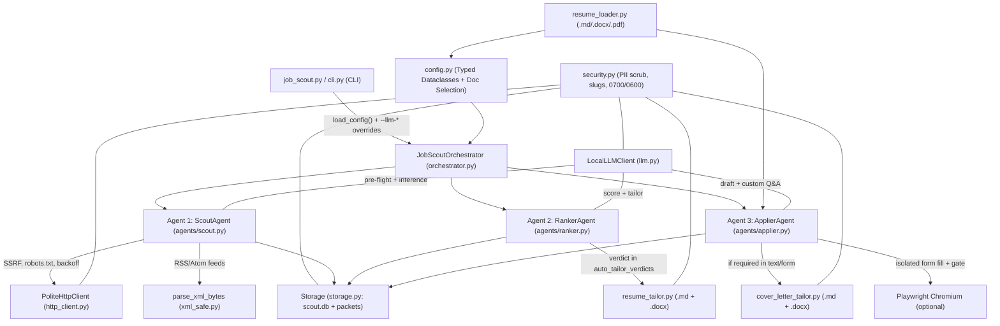
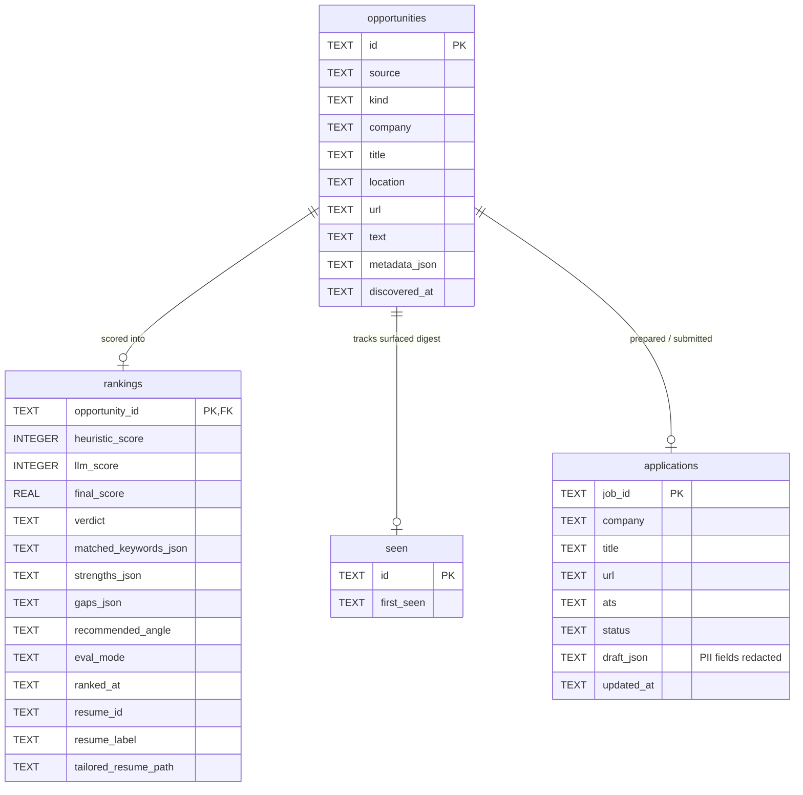
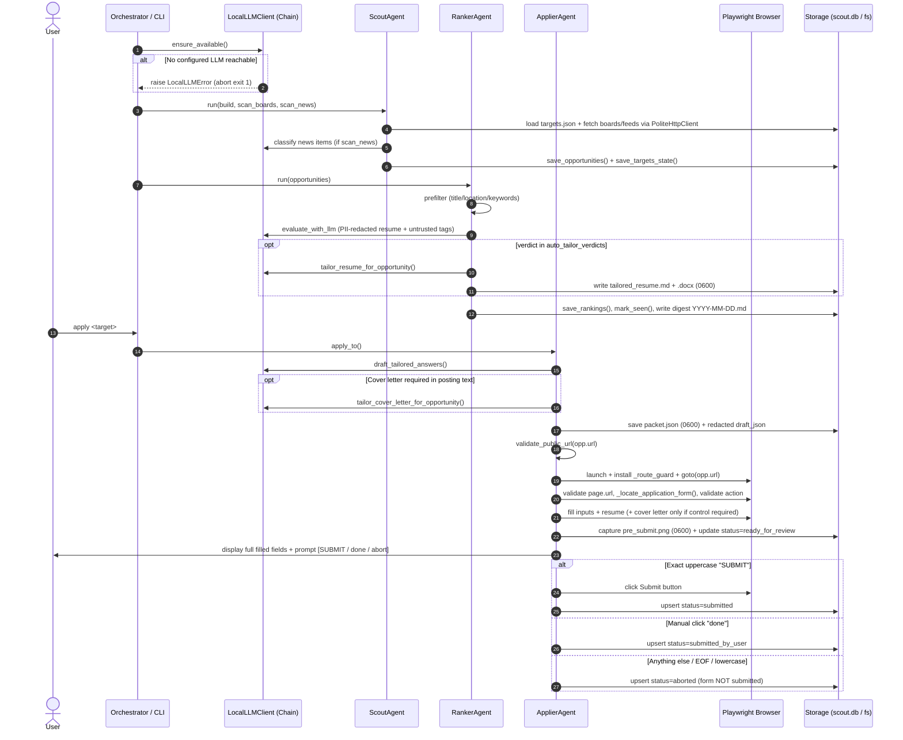
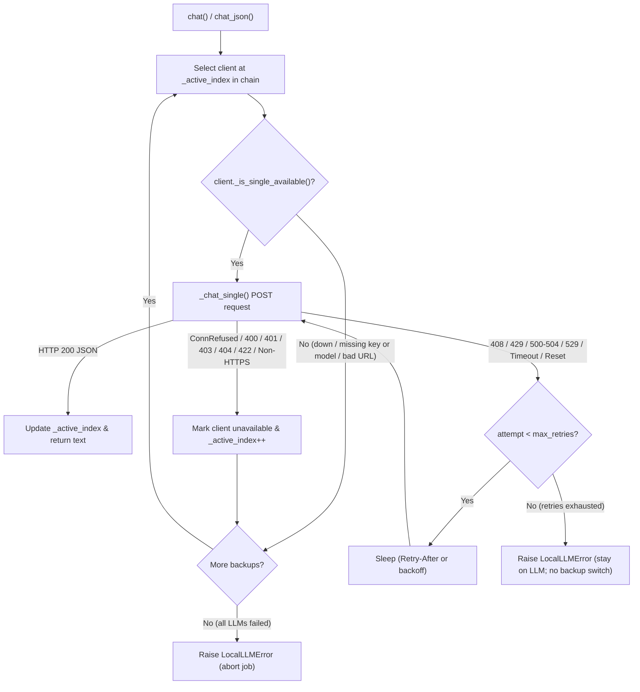

# JobScout Architecture & Technical Design

This document describes the internal architecture, data flow, concurrency model, LLM routing, and security boundaries of JobScout (`v0.1.0a1`, alpha) for engineers reading, extending, or auditing the codebase.

---

## 1. Design Tenets

1. **Zero-dependency core**: The entire discovery, HTTP politeness, storage, `.docx` extraction/generation, and multi-provider LLM HTTP stack (`ScoutAgent`, `RankerAgent`, `LocalLLMClient`, `PoliteHttpClient`, `Storage`) relies strictly on the Python 3.10+ standard library. Optional packages (`playwright`, `pypdf`, `defusedxml`) enhance browser automation, compressed PDF parsing, and XML hardening cleanly when installed.
2. **Fail-fast LLM requirement**: All pipeline execution (`scout`, `rank`, `run`, `apply`) verifies an available configured LLM upfront via `LocalLLMClient.ensure_available()` before scraping boards or scoring opportunities.
3. **Deterministic pre-filtering before inference**: Title, location, domain regexes, and keyword heuristics reduce candidate volume before LLM calls are made.
4. **Local-first state & strict human-in-the-loop gate**: User configuration, SQLite history, tailored resumes/cover letters, and application packets live under `JOB_SCOUT_HOME` (default `~/job-scout/`) with restrictive owner permissions (`0700`/`0600`), and `ApplierAgent` never clicks submit without explicit confirmation (`SUBMIT` or manual `done`).

---

## 2. High-Level Module Architecture

### Package Layout

| Module | Responsibility |
|---|---|
| `job_scout.py`, `jobscout/cli.py` | Argument parsing (`init`, `run`, `scout`, `rank`, `queue`, `apply`, `targets`, `status`), `--llm-*` CLI overrides, exit-code mapping (`LocalLLMError` → exit `1`). |
| `jobscout/orchestrator.py` | Coordinates `ScoutAgent → RankerAgent → ApplierAgent`, resolves apply targets (`queue index` \| `opportunity id` \| `http(s) URL`), runs `ensure_available()` pre-flight checks. |
| `jobscout/config.py` | Loads JSON config into typed dataclasses (`ScoutConfig`, `CandidateConfig`, `TargetingConfig`, `LLMConfig`, `ApplierConfig`, `PolitenessConfig`) and resolves `.md`/`.docx`/`.pdf` documents. |
| `jobscout/models.py` | Core data contracts: `Opportunity`, `ResumeProfile`, `RankedOpportunity`, `ApplicationDraft`. |
| `jobscout/storage.py` | SQLite persistence (`scout.db`), `targets.json` state, private file/directory creation (`0700`/`0600`), and DB PII redaction. |
| `jobscout/llm.py` | Stdlib HTTP client for local and cloud LLMs with exact local model verification, transient retry handling, and ordered backup failover. |
| `jobscout/http_client.py` | Thread-safe, per-host throttled HTTP client with SSRF validation, `robots.txt` enforcement, bounded reads, gzip-bomb defense, and `Retry-After` backoff. |
| `jobscout/security.py` | PII redaction for LLM prompts, untrusted prompt delimiter wrapping, CR/LF & XML control-char sanitization, ATS slug & `api_key_env` allowlist validation, POSIX permissions. |
| `jobscout/xml_safe.py` | Safe XML parser using `defusedxml` when installed, or rejecting `<!DOCTYPE` / `<!ENTITY` before `ElementTree.fromstring`. |
| `jobscout/resume_loader.py` | `.md`/`.txt`, bounded ZIP/OOXML `.docx`, and optional `pypdf` `.pdf` text extraction. |
| `jobscout/resume_tailor.py` | Multi-resume synthesis (`tailored_resume.md` + stdlib OOXML `.docx`). |
| `jobscout/cover_letter_tailor.py` | Conditional cover-letter requirement detection and multi-sample synthesis (`custom_cover_letter.md` + `.docx`). |

---

## 3. Configuration & Profile Resolution Lifecycle

`load_config()` in `jobscout/config.py` decouples the package installation directory from mutable user state:

1. **Home directory**: `--home` CLI flag → `$JOB_SCOUT_HOME` env var → `~/job-scout`.
2. **Profile discovery**: `--profile` CLI flag → `<home_dir>/profile.json` → `./profile.json`. Unconfigured runs fall back to dataclass defaults. `init` seeds starter files from packaged `jobscout/templates/` (`profile.example.json`, `resume.example.md`) via `importlib.resources`.
3. **Document loading (`_load_documents`)**: Resolves `resumes` and `cover_letters` relative to `profile.json`'s parent directory (or `<home_dir>`). Relative paths are joined to `base_dir`; `~` paths are expanded. Text extraction follows: inline `text` → `text_path` → `file_path` (supporting `.md`, `.txt`, `.markdown`, `.docx`, `.pdf`).
4. **Role/Keyword Matching (`_select_best_profile`)**: Used by both `select_resume_for()` and `select_cover_letter_for()`. Each configured profile is scored deterministically against the opportunity (`+5` per `target_roles` substring in title, `+2` if in body text; `+2` per `target_keywords` hit in title + text).

---

## 4. Persistence & Data Model

### SQLite Schema (`scout.db`)

All mutable pipeline state lives in a single SQLite database (`<home_dir>/scout.db`) opened per operation via `contextlib.closing(self._connect())`. DDL runs once per `Storage` instance (`_db_ready`), including lightweight column migration (`ALTER TABLE rankings ADD COLUMN tailored_resume_path`) and `chmod 0600`.

- **`opportunities`**: `id` (`"<source>:<company>:<job_id>"`), `source`, `kind` (`"job"` | `"news_lead"`), `company`, `title`, `location`, `url`, `text`, `metadata_json`, `discovered_at`. Upserts keep the longer description text on conflict.
- **`rankings`**: `opportunity_id` (PK/FK), `heuristic_score`, `llm_score`, `final_score`, `verdict` (`strong_match` | `good_match` | `stretch` | `skip`), JSON-serialized `matched_keywords`, `strengths`, `gaps`, `recommended_angle`, `eval_mode`, `ranked_at`, `resume_id`, `resume_label`, `tailored_resume_path`.
- **`seen`**: `id`, `first_seen` ISO timestamp; tracks already-surfaced opportunities so daily digests focus on unseen matches unless `--all` is passed.
- **`applications`**: `job_id` (PK), `company`, `title`, `url`, `ats`, `status`, `draft_json`, `updated_at`. Transitions (`prepared` → `ready_for_review` → `submitted` / `submitted_by_user` / `aborted`) upsert a single row per `job_id`. Before writing `draft_json`, `Storage._redact_draft_for_db()` replaces sensitive candidate fields (`email`, `phone`, `desired_compensation`, `work_authorization`, `require_sponsorship`, `notice_period`, address fields) with `"[REDACTED]"`. Voluntary self-identification entries in `filled_inputs` (`[EEO] <label> <- <value>`) keep their label but have the value replaced with `"[REDACTED]"`.

### File Artifacts (`<home_dir>`)

- **`targets.json`**: Caches ATS board discovery (`resolved`, `unresolved` with `retry_unresolved_days` TTL, `ignored`).
- **`digests/YYYY-MM-DD.md`**: Daily Markdown digest grouped into job matches (with Remotive/RemoteOK source attribution when configured) and news leads.
- **`applications/<safe_job_id>/`**: Per-application workspace (`safe_job_id` stripped to `[A-Za-z0-9_-]`, max 80 chars, fallback `"unknown"`) holding `packet.json`, `answers.md`, `tailored_resume.{md,docx}`, optional `custom_cover_letter.{md,docx}`, and `pre_submit.png`.

---

## 5. Multi-Agent Execution Pipeline

### Stage 1: `ScoutAgent` (`jobscout/agents/scout.py`)

`ScoutAgent.run()` runs discovery and polling in four phases:

1. **Opt-in job feeds (`fetch_feed_jobs`)**: Polls `remotive` and `remoteok` JSON APIs only when enabled in `targeting.sources`, attaching required source attribution metadata.
2. **Newsfeed scouting (`scour_news`)**: Parses enabled RSS 2.0 / Atom feeds cleanly via `parse_feed_xml()`, pre-filters entries using `is_news_signal()` / `domain_matches()`, optionally fetches HTML article bodies (`fetch_article_body: true`) through `_ArticleTextExtractor`, and classifies leads with the LLM (`_analyze_news_with_llm`).
3. **Target resolution (`build_targets`)**: Ranks candidate company names from `seed_companies`, news leads, HN Algolia *"Who is hiring?"* (`hn_candidates`), and feed companies. Resolves uncached candidates concurrently via `ThreadPoolExecutor(max_workers=6)`, probing candidate `slug_variants` against Greenhouse, Ashby, and Lever metadata APIs (verifying Greenhouse board name similarity via `names_match`).
4. **ATS polling (`watch_list` → `fetch_ats`)**: Polls all non-ignored resolved boards and validated `manual_targets` concurrently (`ThreadPoolExecutor(max_workers=8)`), normalizing listings into `Opportunity` records saved to `scout.db`.

### Stage 2: `RankerAgent` (`jobscout/agents/ranker.py`) + `resume_tailor.py`

1. **Stage-1 Pre-filter (`prefilter`)**: Validates non-empty URLs, applies `TargetingConfig.title_matches()` and `location_matches()` to jobs, computes `compute_heuristic()` (`keyword_weights` hits + seniority regex boosts + domain/news signals), and sorts descending.
2. **Stage-2 LLM Evaluation (`evaluate_with_llm`)**: Evaluates the top `max_ranker_evals_per_run` pre-filtered candidates via `self.llm.chat_json()`, combining scores as:
   $$\text{final\_score} = 0.75 \times \text{llm\_score} + 0.25 \times \min(100, \text{heuristic\_pts} \times 4)$$
   and normalizing `verdict` (`strong_match`, `good_match`, `stretch`, `skip`).
3. **Multi-Resume Synthesis (`tailor_resume_for_opportunity`)**: For jobs whose verdict is in `targeting.auto_tailor_verdicts` (default `["strong_match", "good_match"]`), `resume_tailor.py` passes PII-scrubbed excerpts of **all** configured resumes to the LLM to synthesize one grounded resume (strictly prohibiting invented employers, titles, dates, degrees, or metrics), re-attaches local candidate contact headers, writes `tailored_resume.md`, and generates a valid OOXML archive (`tailored_resume.docx`) using stdlib `zipfile` + XML escaping. Falls back cleanly to deterministic heuristic bullet merging if synthesis raises an unexpected parse error.
4. **Digest & Notification**: Filters out `verdict == "skip"` (and previously seen IDs unless `--all`); `--all` re-evaluates already-ranked jobs but LLM scoring is still capped at `max_ranker_evals_per_run`, updates `seen` (unless `--dry-run`), writes the daily digest, and triggers a sanitized macOS `osascript` notification when matches exist.

### Stage 3: `ApplierAgent` (`jobscout/agents/applier.py`) + `cover_letter_tailor.py`

1. **Draft Preparation (`prepare_draft`)**:
   - Resolves the resume (`--resume-id` override → tailored `.docx`/`.md` from `applications/<id>/` or synthesized on demand when `tailor=True` → matched static `ResumeProfile`).
   - Drafts `why_company`, `relevant_experience`, and `cover_note` answers via LLM (`draft_tailored_answers`).
   - Evaluates `require_cover_letter or is_cover_letter_required_in_text(opp.text)`. Only when **explicitly required** (rejecting optional/negative phrasing like `"cover letter is optional"`), `tailor_cover_letter_for_opportunity()` synthesizes `custom_cover_letter.docx` + `.md` from all configured `cover_letters` samples and the active resume.
   - Persists `packet.json`, `answers.md`, and the redacted `applications` database row.
2. **Browser Form Filling & Safety Gate (`run` with Playwright)**:
   - Validates `opp.url` with `validate_public_url()` before launching Chromium; registers `context.route("**/*", _route_guard)` to abort requests targeting private hosts or non-`http(s)` schemes.
   - Navigates (`domcontentloaded`), clicks an Apply button if no form email control is visible (`_maybe_open_apply_form`), re-validates landed `page.url`, and isolates the dedicated application `<form>` (`_locate_application_form` preferring `#application_form` / `apply` forms and rejecting `role="search"` / search / newsletter forms).
   - Validates `<form action>` against `validate_public_url()` and blocks HTTP downgrade targets on HTTPS pages.
   - Inside `app_form`, handles file uploads (separating cover-letter file inputs—generating & uploading only if required—from resume uploads) and empty visible text/textarea controls (`match_field_key`, conditional cover letter textareas, or `answer_custom_question` for free-form textareas), skipping `password`, `hidden`, `submit`, `button`, `file`, `checkbox`, `radio`, `reset`, and `image` types.
   - Captures full-page `pre_submit.png`, highlights the form's submit button, prints **full** drafted field values, updates DB status to `ready_for_review`, and pauses on `approval_callback` / `_default_approval_prompt`: only exact uppercase `SUBMIT` clicks the button automatically; `done` records manual user submission; anything else (`abort`, EOF, empty input, lowercase `submit`) cancels without submitting.

---

## 6. Multi-Provider LLM Client, Retries & Backup Failover

`LocalLLMClient` (`jobscout/llm.py`) supports local and cloud backends over Python stdlib `urllib.request`:

| Provider Key / Aliases | Endpoint | Auth Mechanism | Notes |
|---|---|---|---|
| `ollama`, `llama` | `/api/tags`, `/api/chat` | None (local) | Default `http://localhost:11434`. |
| `openai_compat`, `mlx`, `mlx_lm`, `lmstudio`, `vllm`, `llama_cpp` | `/v1/models`, `/v1/chat/completions` | None (local) | OpenAI-compatible local inference servers. |
| `openai`, `chatgpt` | `/v1/chat/completions` | `Authorization: Bearer` | Enforces `https://`, uses `OPENAI_API_KEY`. |
| `gemini`, `google` | `/v1beta/models/{model}:generateContent` | `x-goog-api-key` | Enforces `https://`, uses `GEMINI_API_KEY` or `GOOGLE_API_KEY`. |
| `anthropic`, `claude` | `/v1/messages` | `x-api-key` + `anthropic-version: 2023-06-01` | Enforces `https://`, uses `ANTHROPIC_API_KEY`. |

### Exact Model Matching & Ordered Chain Execution

- **No silent model substitution**: Local servers query `/api/tags` or `/v1/models` and require `self.model in names`.
- **Retry vs. Backup Failover Decision**:
  - `LLMConfig.backups` constructs an ordered client chain `[primary, backup_1, backup_2, ...]` tracked by `_active_index`.
  - **Transient errors (`_RetryableLLMError`)** — HTTP `408`, `429`, `500`, `502`, `503`, `504`, `529`, `TimeoutError`, `socket.timeout`, `ConnectionResetError`, `http.client.RemoteDisconnected` — **retry the same LLM** up to `max_retries` times (honoring `Retry-After` capped at `30s`, or `retry_backoff_seconds * 2^attempt`). If retries are exhausted, `LocalLLMError` is raised without silently switching backups.
  - **Non-retryable / down errors (`_NonRetryableLLMError`)** — `ConnectionRefusedError`, unreachable host, missing API key, missing local model, invalid/non-HTTPS `base_url`, or HTTP `400`/`401`/`403`/`404`/`422` — mark that client unavailable and immediately fail over to the next client in `backups`.

---

## 7. Network, Security & PII Architecture

Defense-in-depth controls across `jobscout/http_client.py`, `jobscout/security.py`, `jobscout/xml_safe.py`, and `jobscout/agents/applier.py`:

- **SSRF & Redirect Protection**: `validate_public_url()` requires `http`/`https`, rejects embedded `user:pass@` credentials, unwraps IPv4-mapped IPv6 addresses (`::ffff:...`), and blocks all non-global IPs (`not ip.is_global`, covering loopback, RFC1918, link-local metadata `169.254.169.254`, CGNAT `100.64.0.0/10`, multicast, `.local`/`.internal` hostnames, and DNS resolutions returning non-public IPs). Applied in `PoliteHttpClient.can_fetch()`, `_SafeRedirectHandler`, `ScoutAgent._make_job()`, and Playwright navigation/route/form-action guards.
- **HTTP Politeness & Header/Body Safety**: `PoliteHttpClient` maintains thread-safe per-origin `robots.txt` policies (failing closed on `401`/`403`/`429`/5xx/unreachable, allowing on `404`/`410`), per-host serialization locks enforcing `max(min_delay_seconds, Crawl-delay, Request-rate)` plus `429`/`503` `Retry-After` cooldowns, CR/LF stripping on `User-Agent`/`From`, and bounded response/streaming-gzip decompression (`10 MiB` cap to prevent memory/gzip bombs).
- **LLM PII Redaction & Prompt Hardening**: `redact_pii_for_llm()` strips emails, phone numbers, SSNs, and sensitive candidate fields (`email`, `phone`, `desired_compensation`, `work_authorization`, `require_sponsorship`, `notice_period`) from all resume/cover-letter prompts. Untrusted external job descriptions, news articles, and form questions are stripped of ASCII control chars and wrapped in `<untrusted_*>` delimiters (`wrap_untrusted()`).
- **Credential & Input Hygiene**: `is_allowed_api_key_env()` prevents untrusted profiles from exfiltrating arbitrary environment variables; `is_valid_ats_slug()` prevents path/query/fragment injection into ATS URLs; `parse_xml_bytes()` rejects XML `DOCTYPE`/`ENTITY` (or uses `defusedxml`); `extract_docx_text()` enforces `10 MiB` per XML entry / `25 MiB` total bounds; OOXML generators strip XML 1.0 invalid control characters.
- **At-Rest Data Protection**: `JOB_SCOUT_HOME`, subdirectories, SQLite DB, targets state, tailored documents, digests, application packets, and screenshots are created with `0700`/`0600` POSIX permissions, and DB `draft_json` redacts raw PII fields.

---

## 8. Testing Strategy & Extension Points

### Hermetic Test Suite (`tests/test_agents.py`)

Tests run without network, browser, or local LLM daemons using `unittest` and stdlib mocks:
- `PoliteHttpClient` tests inject deterministic `clock_fn`, `sleep_fn`, and `opener` callables.
- `LocalLLMClient` tests mock `urllib.request.urlopen` and `sleep_fn` to verify cloud request shapes/headers, exact local model matching, retry backoff, and backup failover.
- `ApplierAgent` tests mock Playwright `sync_playwright`, page locators, and `builtins.input` approval gates, using temp `JOB_SCOUT_HOME` directories and hermetic `--profile` files.

### Common Extension Points

- **New job/news source**: Add a fetcher method to `ScoutAgent`, wire an opt-in flag in `TargetingConfig.sources`, construct normalized items via `_make_job()` (which validates URLs and attaches source attribution).
- **New ATS provider**: Add metadata URL template and parser in `ScoutAgent` (`probe`, `fetch_ats`), URL detection in `applier.detect_ats()`, and slug validation via `is_valid_ats_slug()`.
- **New LLM provider**: Add default endpoint/model/env metadata to `_PROVIDER_DEFAULTS` and request/response handling in `LocalLLMClient._chat_single()`, ensuring `is_cloud_provider` enforces HTTPS and `_resolve_api_key()` stays gated by `is_allowed_api_key_env()`.
- **New form field mapping**: Append `(field_key, regex)` to `FIELD_MATCHERS` in `jobscout/agents/applier.py` and keep any sensitive field keys redacted in `_SENSITIVE_DRAFT_FIELDS` (`storage.py`) and `redact_pii_for_llm()` (`security.py`).
